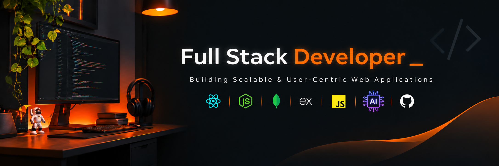

<!-- Profile Banner -->

  

<h1 align="center">Hey there, I'm Siva Sundaram 👋</h1>

<h3 align="center">Full-Stack Developer | MERN Stack | Java | AI Integration</h3>

  Building scalable, user-centric web applications and exploring AI-powered solutions.

---

## 👨‍💻 About Me

I'm a passionate Full-Stack Developer interested in building modern web applications and integrating AI into real-world solutions.

- 💻 Building full-stack applications using the MERN stack.
- ⚡ Exploring Next.js and modern frontend technologies.
- ☕ Working with Java and Spring Boot for backend development.
- 🤖 Exploring AI integration using OpenAI APIs and LLMs.
- 🚀 Enjoy turning ideas into practical applications.
- 🌱 Always learning and improving my development skills.

---

## 🛠️ Tech Stack

### 🎨 Frontend

  
  &nbsp;&nbsp;&nbsp;
  
  &nbsp;&nbsp;&nbsp;
  
  &nbsp;&nbsp;&nbsp;
  
  &nbsp;&nbsp;&nbsp;
  
  &nbsp;&nbsp;&nbsp;
  

### ⚙️ Backend

  
  &nbsp;&nbsp;&nbsp;
  
  &nbsp;&nbsp;&nbsp;
  
  &nbsp;&nbsp;&nbsp;
  

### 🗄️ Database & Tools

  
  &nbsp;&nbsp;&nbsp;
  
  &nbsp;&nbsp;&nbsp;
  
  &nbsp;&nbsp;&nbsp;
  
  &nbsp;&nbsp;&nbsp;
  
  &nbsp;&nbsp;&nbsp;
  

### 💻 Programming Languages

  
  &nbsp;&nbsp;&nbsp;
  
  &nbsp;&nbsp;&nbsp;
  

### 🤖 AI Integration

  
  &nbsp;&nbsp;
  

---

## 🚀 Featured Projects

### 🏠 Home Service Instant Quote Estimator

AI-powered home service estimation platform built using the MERN stack, integrating OpenAI for property image analysis and AI-assisted recommendations.

**Tech:** React · Node.js · Express · MongoDB · OpenAI · Cloudinary

[View Project →](https://github.com/raven-sr/home-service-instant-quote-estimator)

### 📋 Requirement Posting Application

Full-stack requirement posting application built using Next.js, Express.js, MongoDB and Bootstrap.

**Tech:** Next.js · Express · MongoDB · Bootstrap

[View Project →](https://github.com/raven-sr/gopratle-requirement-posting)

### 🛒 E-Commerce Application

Full-stack e-commerce application featuring authentication, product management, category filtering, shopping cart and admin dashboard.

**Tech:** React · Redux Toolkit · Node.js · Express · MongoDB · Cloudinary

[View Project →](https://github.com/raven-sr/Ecommerce)

### 👨‍💼 Employee Management System

Full-stack employee management application featuring employee CRUD operations and REST API integration.

**Tech:** React · HTML · CSS · Java · Spring Boot

[View Project →](https://github.com/raven-sr/Employee-Management-System)

### 🖼️ Photo Gallery

Responsive photo gallery application with search, favourites and local storage persistence.

**Tech:** React · Vite · Tailwind CSS

[View Project →](https://github.com/raven-sr/photo-gallery)

---

## 📊 GitHub Statistics

  
  &nbsp;&nbsp;
  

  

---

## 🤝 Connect With Me

  
  &nbsp;&nbsp;
  

---

  <b>Thanks for visiting my profile! 👋</b>
   
  <i>Keep Learning. Keep Building. Keep Growing. 🚀</i>

